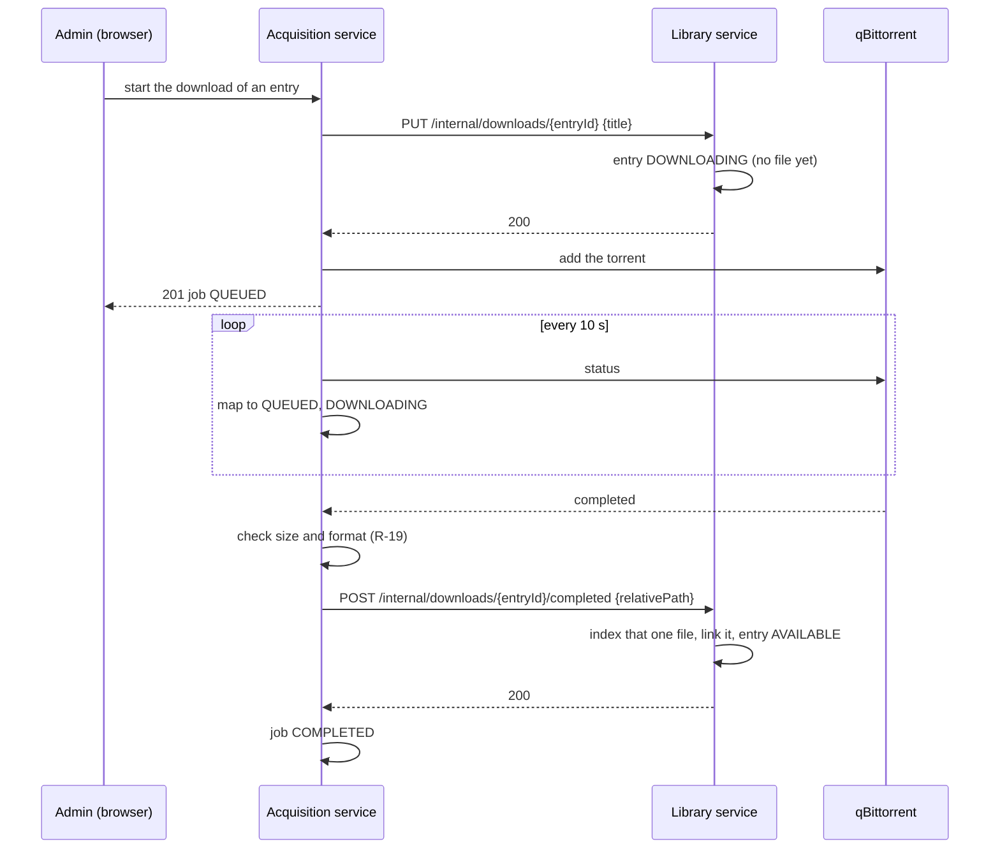

# Cross-service consistency rules

What must stay true across services when each one owns its own database, and the mechanism that keeps it true. Covers ARC-05, SEC-07, ACQ-07 and CAT-01, risks R-13 and R-22 (issue #13), and settles open questions 5 and 6 of the [requirements](../product/requirements.md). The way services call each other is [ADR-0022](../adr/0022-internal-service-calls.md); the timeouts and the failure answer are in the [error model](error-model.md).

## Principles

1. **One owner per fact.** A service changes only its own tables (ADR-0006). To change another service's data, it calls that service.
2. **No shared transaction.** There is no distributed transaction. Every rule is a sequence of calls in an order chosen so that a failure in the middle leaves a state that is harmless and can be repeated.
3. **Calls are idempotent.** Repeating a call has the same effect as making it once, so a retry never does damage. The automatic retry is still only for `GET` (error model), so a repeat is made by the caller's own loop or by the user.
4. **A failure is visible.** A call that cannot be completed answers 503 (`service_unavailable`) to the user, or puts the job in a failed state the administrator can see. Nothing fails silently.
5. **References are plain ids.** `profile_id`, `acquisition_entry_id` and `started_by` carry no foreign key (data model). The reference may point to something that no longer exists, so each reader tolerates a missing target.

## Summary

| Rule | Trigger | Mechanism | Order |
|---|---|---|---|
| [Delete a profile](#deleting-a-profile) | A user deletes a profile | Identity calls the library, synchronously | Library first, then identity |
| [Delete an account](#deleting-an-account) | A user or administrator deletes an account | Same call, once per profile | Library first, then identity |
| [Start a download](#acquisition-handoff) | An administrator starts a job | Acquisition calls the library | Library first, then the torrent client |
| [Finish a download](#acquisition-handoff) | The torrent client reports completion | Acquisition calls the library, repeated until it works or times out | After the size and format check |
| [Fail or cancel a download](#acquisition-handoff) | A job fails or is cancelled | Acquisition calls the library, repeated until it works | After the job is marked failed |
| Disable an account | An administrator disables an account | **None.** The next token renewal fails ([identity design](identity-and-permissions.md#expiry-and-renewal)) | n/a |

## Internal endpoints

Only these calls exist. All are under `/internal`, are refused with 404 by the gateway, and need the caller's `X-Service-Token` (ADR-0022). They use the common error body (ADR-0020) and the usual timeouts: 2 s to connect, 5 s to read.

| Called service | Caller | Endpoint | Effect |
|---|---|---|---|
| Library | Identity | `DELETE /internal/profiles/{profileId}/data` | Deletes the favourites and the viewing progress of this profile. `204` even when there is nothing to delete. |
| Library | Acquisition | `PUT /internal/downloads/{entryId}` with `{ "title": "..." }` | Creates the catalogue entry as `DOWNLOADING`, or makes an existing entry without a file `DOWNLOADING` again. `200`. |
| Library | Acquisition | `POST /internal/downloads/{entryId}/completed` with `{ "relativePath": "..." }` | Links the downloaded file to the entry and makes it `AVAILABLE`. `200` with the media id. |
| Library | Acquisition | `POST /internal/downloads/{entryId}/failed` | Makes a `DOWNLOADING` entry `UNAVAILABLE`. `204`. |

No endpoint of the identity or the acquisition service is called by another service. Every service checks user tokens itself with the public key ([identity design](identity-and-permissions.md)), so no service calls identity to validate a request. These endpoints are written into the OpenAPI contracts (`docs/api/`) in the pull request that implements each one (ADR-0010).

## Deleting a profile

Open question 6. `DELETE /profiles/{profileId}` in the identity service (the contract is in `docs/api/identity.yaml`).

1. Identity checks that the profile belongs to the account in the token. If not, 404.
2. Identity calls `DELETE /internal/profiles/{profileId}/data` on the library.
3. If the library answers, identity deletes the profile row and answers 204.
4. If the library does not answer (timeout, refused connection) or answers anything but a 2xx, identity **does not delete the profile** and answers 503. The user tries again. A 4xx also counts, so a library without the endpoint, or a wrong service token, never leads to a profile deleted with its data left behind.

Identity sends its secret for the library in `X-Service-Token` (ADR-0022). It comes from `IDENTITY_TO_LIBRARY_TOKEN` in `.env`, and the identity service refuses to start without it. The library checks the same value when K3 adds the endpoint.

**Why this order.** Deleting the data first means a failure never leaves favourites or progress that belong to a profile that no longer exists, which is what R-13 is about. The opposite order could leave orphan rows that nobody can ever find again, because their profile id is gone. The cost of this order is small: if step 3 fails after step 2 worked, the profile exists with an empty list and an empty progress, which is harmless and is repaired by repeating the request.

**Source media is never touched** (SEC-07): the library deletes rows in `favourite` and `progress` only.

K3 builds the library endpoint, and the profile deletion in identity (G9) calls it.

## Deleting an account

Open question 6, and SEC-07 (K2). `DELETE` of an account is an administrator operation, or the account's own.

1. Identity lists the account's profiles (at most 5).
2. For each profile, identity calls the same library endpoint, one after the other.
3. If any call fails, identity stops, **does not delete the account**, and answers 503. The calls already made are not undone and need not be: they are idempotent, and the account still works, with an empty list for those profiles.
4. When every call has worked, identity deletes the account. Its profiles go with it (`ON DELETE CASCADE`).

Other rules:

- The **last administrator** cannot be deleted ([identity design](identity-and-permissions.md#roles-and-permissions)).
- The acquisition service keeps `download_job.started_by`. It is an opaque id with no email or name (SEC-06), so it is not personal data once the account is gone, and it keeps the audit trail. It is not deleted.
- A token that was signed before the deletion stays valid for up to 15 minutes ([R-10](../risks.md)). In that window it can still read the catalogue. If its profile id is used to write a favourite or progress, the row is **orphaned**: it belongs to a profile that no longer exists. This is a known limit of having no revocation list. The rows are unreachable by anyone, they are small, and they are not removed in the MVP.

## Acquisition handoff

Open question 5, ACQ-07 and R-22. The acquisition service owns the download and the library owns the catalogue, so the two states must be moved together.

### Starting

1. Acquisition checks that the caller is an administrator and that no job is active for this entry (unique index, data model).
2. Acquisition calls `PUT /internal/downloads/{entryId}`. The library creates the catalogue entry with the title, availability `DOWNLOADING` and `acquisition_entry_id` set. The entry id is unique, so a repeated call creates no second entry (data model, V2 migration).
   - No entry yet: created as `DOWNLOADING`.
   - An entry already `DOWNLOADING`: nothing changes.
   - An entry `UNAVAILABLE` and without a file (a previous attempt failed): made `DOWNLOADING` again, keeping what an administrator edited.
   - An entry `AVAILABLE`: `409 already_in_library`. The title is already in the library, and the job is refused.
3. If the library does not answer, acquisition answers 503 and **does not start the torrent**. Nothing was created on either side.
4. Acquisition adds the torrent and creates the job `QUEUED`. If the torrent client refuses, the job is `FAILED` and the failure is notified as below.

The library is called first so that the interface never shows a download in progress that the catalogue does not know about.

### Completing

When the torrent client reports the file complete, acquisition checks the size and format (R-19, ACQ-06) and then calls `POST /internal/downloads/{entryId}/completed` with the path **relative to the downloads folder**.

The library, in one transaction:

1. Checks the path with the same guard as every file path, so a `..` or a link outside the downloads folder is refused (LIB-08, R-01).
2. Checks that the downloads folder is an authorized root and that the file exists and is readable. The documentation of the configuration (L4) tells the administrator to authorize it.
3. Creates the file record, or reuses one that a scan already created, and links it to the entry.
4. Makes the entry `AVAILABLE`.

The call is idempotent: if the entry is already `AVAILABLE` with the same file, it answers 200 and changes nothing.

**A scan may find the file first.** A manual indexing of the downloads folder (H5) can see the finished file before this call arrives and create an entry for it. The download entry then wins: in the same transaction the library removes the entry the scan created and links the file to the download entry. The scan's entry has just been created, so it has no favourite, progress or edits worth keeping.

### Time limit and visible failure

- Between "the torrent client says complete" and "the library confirmed", the job stays `DOWNLOADING` at 100 %. The screen can show it as finishing.
- If the library does not answer or refuses, acquisition **tries again at the next 10-second status check**. It does not rely on the automatic retry, which is for `GET` only.
- After **5 minutes** without success the job becomes `FAILED` with `error_code = 'handoff_failed'`. The administrator sees it in the download screen (ACQ-04), with a plain message. The detail goes to the log only (SEC-04).
- The size and format check can also fail the job, with `error_code = 'verification_failed'`. Nothing is handed over.
- A cancelled job is `FAILED` with `error_code = 'cancelled'` (data model).

The limit is a setting (`ACQUISITION_HANDOFF_TIMEOUT`), so it can be tuned. A test covers a library that is down for longer than the limit (TST-05, R-22).

### Failing and cancelling

Whenever a job becomes `FAILED`, acquisition calls `POST /internal/downloads/{entryId}/failed`. The library makes a `DOWNLOADING` entry `UNAVAILABLE`, so the catalogue does not show a download that is no longer running. The entry keeps its title and can be downloaded again (see "Starting"), or removed by an administrator (H8).

If the library does not answer, the job stays marked as not yet notified, and acquisition repeats the call at each status check until it works. Until then the title shows as downloading, which is the only visible inconsistency, and it ends by itself.

A failure is told under the entry's lock, which a start also holds while it tells the library that the title downloads. A failure of an earlier attempt is not told once the entry has a newer job, since the library then follows that job. So a late failure notice can never make the entry `UNAVAILABLE` while a new attempt downloads.

The job table needs one extra column for this, `library_synced_at` (null while a notification is pending). It is added to the data model with this document, and created by the acquisition migration (J3).

### Restart

Acquisition rebuilds its state from its own database and the torrent client when it starts. Any job that is `DOWNLOADING` at 100 % goes back to the handoff, and any `FAILED` job that is not yet notified goes back to the failure call. The library keeps no state about the handoff apart from the entry, so a restart of either service loses nothing.

## Other references

- **`media_item.acquisition_entry_id`** is set by the start call and is unique. Removing the entry (H8) leaves the job untouched, and a new start creates a new entry.
- **Removing an authorized folder** (LIB-07) is a library matter: its titles become `UNAVAILABLE` and keep their favourites and progress. No other service is told.
- **Disabling an account** needs no call, as the table above says.

## When a service is down

| Down | Rule | What happens |
|---|---|---|
| Library | Delete a profile or an account | 503, nothing deleted, try again. |
| Library | Start a download | 503, nothing started. |
| Library | Complete a download | The job stays at 100 %, repeats every 10 s, fails after 5 minutes. |
| Library | Fail a download | The job is failed, the title shows as downloading until the library is back. |
| Identity | Any of these rules | Nothing here needs identity. Users already signed in keep their access until the token expires, and then cannot renew. |
| Acquisition | Delete a profile or an account | No effect. The job rows keep an opaque account id. |

## What this asks of the issues

- **K3 and G9:** the library endpoint for profile data, and the order in the profile deletion (library first).
- **K2 and G8:** the account deletion in the same order, and the last-administrator rule.
- **J3:** the `library_synced_at` column on `download_job`.
- **J5 to J8:** the calls and the 5-minute limit, in the order above. J8 is the library side, including the merge with a scan.
- **Gateway:** one rule that answers 404 for `/api/<service>/internal/`, with a test. It is part of the first issue that adds an internal endpoint (K3).
- **L4:** the two service tokens and the `ACQUISITION_HANDOFF_TIMEOUT` setting, and the instruction to authorize the downloads folder.
- **TST-05 and K9:** a test for each rule with the other service down, and one for the full download path.
