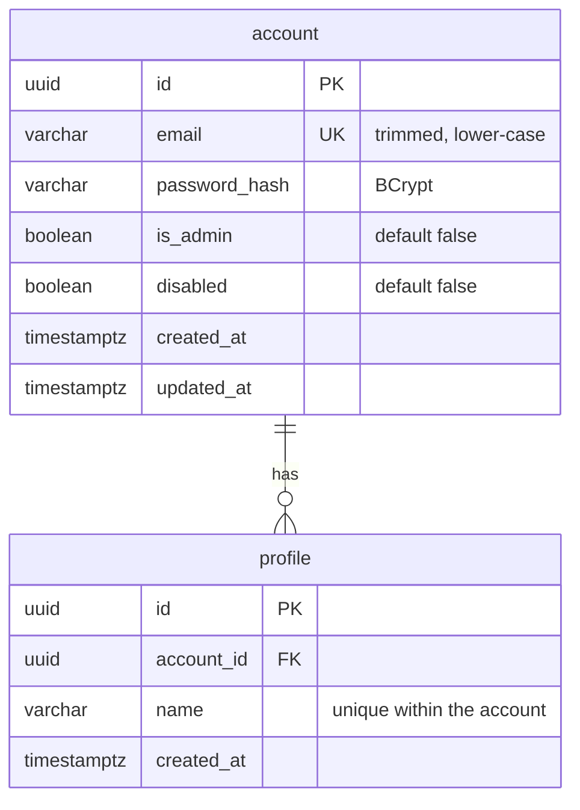
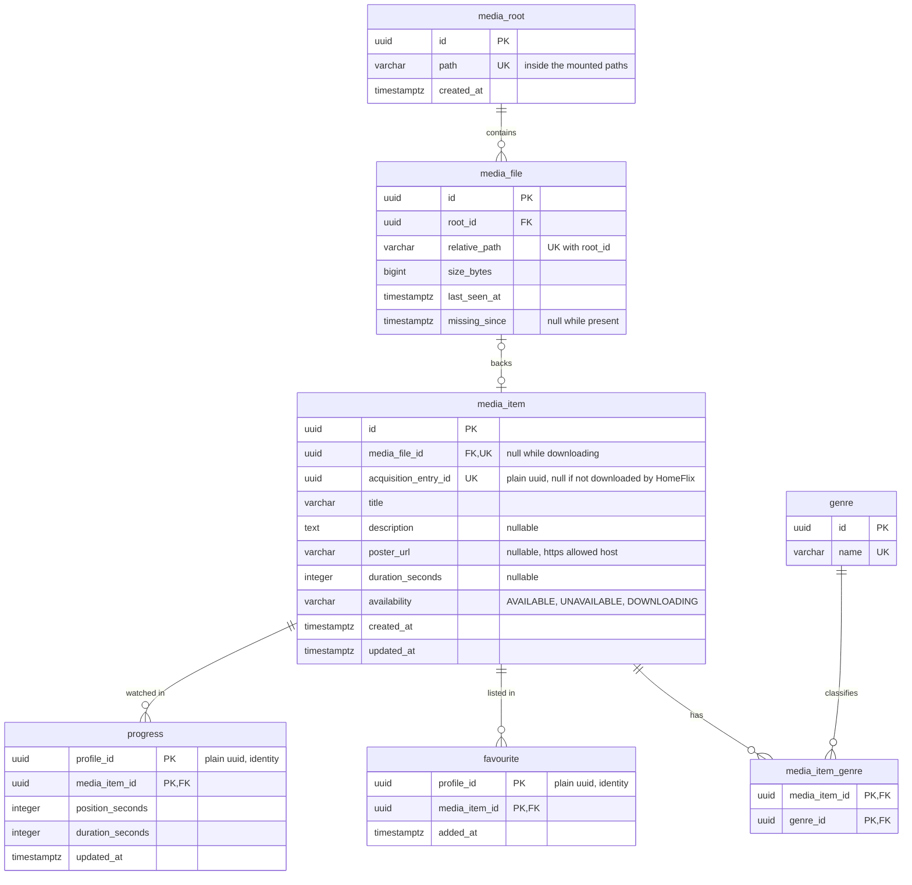
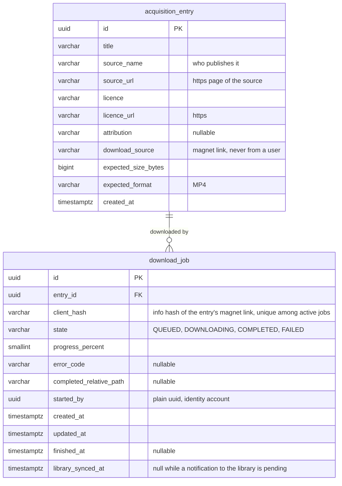

# Data model

Entities, relationships and schemas of each service (ARC-05, issue #12). Each service owns its data in its own PostgreSQL database and user (ADR-0006, ARC-04). It feeds the Flyway migrations of identity (G1), library (H4) and acquisition (J3), see ADR-0007.

Cross-service consistency rules (what happens to a profile's data when the profile is deleted, and so on) are a separate document (issue #13).

## Conventions

- **Primary keys are UUIDs** (`gen_random_uuid()`), because ids travel in tokens and requests between services and must not be guessable (PRF-04). A table that only links two others uses their pair as its key.
- **No foreign key crosses a service.** A reference to another service's row is a plain `uuid` column with no constraint (ADR-0006). The owning service is named in each diagram.
- **Timestamps** are `timestamptz`. Names are `snake_case`. Text that comes from a user is validated on the server (SEC-01).
- **Enumerations** are stored as `varchar` with a `CHECK` constraint listing the values, so a migration can extend them.
- A migration is never edited after merge (ADR-0007).

## Ownership summary

| Service | Owns | Notes |
|---|---|---|
| Identity | `account`, `profile` | `account` already exists (migration V2). |
| Library | `media_root`, `media_file`, `media_item`, `genre`, `media_item_genre`, `favourite`, `progress` | `profile_id` in `favourite` and `progress` is a plain uuid referencing identity. |
| Acquisition | `acquisition_entry`, `download_job` | `started_by` is a plain uuid referencing an identity account. |

## Identity service

- Two roles only, stored as `account.is_admin`: administrator and user (requirements, open question 3). There is no role table.
- A profile belongs to one account, and its name is unique within that account (`UNIQUE (account_id, name)`). It stores a name and nothing else; the interface derives an initial or colour from it. Deleting an account deletes its profiles (`ON DELETE CASCADE`).
- No account is created by a migration: the first administrator comes from the setup flow (ACC-02).

## Library service

### Two tables for one title: the file and the catalogue entry

The indexer and the administrator must not overwrite each other, so a title is split in two:

- **`media_file`** belongs to the indexer: where the file is and whether it is there. The key is `(root_id, relative_path)`, which makes indexing idempotent (LIB-05): a repeated scan updates `last_seen_at` instead of adding a row. A file that is no longer found gets `missing_since`; it is not deleted, so the catalogue keeps its information (LIB-07).
- **`media_item`** is the catalogue entry: title, description, poster, duration and genres (CAT-03). The indexer creates it once, with a title taken from the file name, and never changes these fields afterwards. Administrator edits (CAT-09, CAT-10) are therefore safe from a re-index. Only `availability` is system-written.

A path-based key means a renamed or moved file is seen as a new title, and the old entry becomes unavailable with its favourites and progress. This is a known limit of the MVP.

### Availability (CAT-01)

`media_item.availability` has three values:

| Value | Meaning |
|---|---|
| `AVAILABLE` | The file is present and readable. |
| `UNAVAILABLE` | The file was deleted or became inaccessible (`media_file.missing_since` is set). The entry stays with its metadata. |
| `DOWNLOADING` | A download is in progress. There is no file yet (`media_file_id` is null). |

The indexer and the download notifications write this column; an administrator does not.

The database enforces two rules (migration `V2__create_media_tables.sql`): an `AVAILABLE` title must have a file, and a `DOWNLOADING` title cannot have one yet.

### Removing a root (LIB-07)

Removing an authorized folder deletes its `media_file` rows (`ON DELETE CASCADE`) but never a file on disk, and the catalogue entries stay: `media_item.media_file_id` is set to null (`ON DELETE SET NULL`), so titles keep their metadata, favourites and progress. Because an `AVAILABLE` title must have a file, the service marks its titles `UNAVAILABLE` first and removes the root in the same transaction; removing the root while a title is still `AVAILABLE` is refused by the database.

### Missing metadata (CAT-10)

Only `title` is required. A title without description, poster, genre or duration is still listed, and the interface shows placeholders.

### Poster (ADR-0018)

`poster_url` is plain text. The server validates that it is `https` on an allowed host when it is saved, and never fetches it.

### Genres (CAT-02, CAT-04)

A title can have several genres through `media_item_genre`. The genre filter and the category rows on the home page read the `genre` table, so spelling is controlled. Deleting a catalogue entry deletes its genre links, favourites and progress (`ON DELETE CASCADE`), but never the source file (LIB-12).

### Favourites and progress (PRF-03, CAT-08, PLY-07 to PLY-09)

`favourite` and `progress` have one row per profile and title. `profile_id` is a plain uuid: the library does not know whether the profile still exists, which is a consistency rule: see the [cross-service consistency rules](consistency-rules.md).

- **Started** means `position_seconds` is above a few seconds; **completed** means 90 % or more of `duration_seconds` is watched. Both are computed from the row with one constant in code, not stored, so a flag can never disagree with the position (PLY-09).
- **Reset** deletes the row.

## Acquisition service

### The verified catalogue (ACQ-01, ACQ-02, R-15)

`acquisition_entry` rows are inserted by a **Flyway migration**, reviewed in a pull request like code. Only the team can add or change an entry, and there is no screen or field that accepts a URL or a magnet link (ACQ-09, ACQ-10). Each entry records its source, its licence and the expected size and format, which are checked after the download (R-19). The database refuses an entry whose source or licence page is not `https`, whose download source is not a magnet link with a lower-case v1 info hash followed only by a display name (`dn`) and trackers (`tr`), whose size is not positive or whose format is not `MP4`, and a title or an info hash listed twice (migration `V2__create_acquisition_entry.sql`). Any other magnet parameter (`xs`, `as`, `ws`) is refused because it would make the torrent client fetch an address of its own. An `https` address of a `.torrent` file is refused for now: its info hash is only known once the client has fetched it, so a duplicate or the download could not be checked by its hash. The API never returns the download source.

### Download jobs (ACQ-03 to ACQ-07)

- States are `QUEUED`, `DOWNLOADING`, `COMPLETED` and `FAILED` (ACQ-04). A cancelled job is `FAILED` with `error_code = 'cancelled'`. The other reasons are `client_error`, `torrent_missing` (the torrent is no longer in the client), `handoff_failed` and `verification_failed`. The API returns each reason with a plain-language message.
- The status check (J6) updates `state` and `progress_percent` every 10 seconds from the torrent client. A torrent the client has completed keeps the job `DOWNLOADING` at 100 % until the handoff (J7).
- At most one job per entry is active at a time: a unique index on `entry_id` where `state` is `QUEUED` or `DOWNLOADING`. The same entry always gives the same torrent, so `client_hash` is unique among active jobs only: an entry downloaded again after a cancel has a new job with the same hash. The hash is taken from the entry's magnet link when the job is created, so the torrent can be found or removed in the client even if adding it failed or was interrupted.
- `completed_relative_path` is relative to the downloads folder. After the size and format check it is handed to the library, which indexes it (ACQ-07).
- `started_by` is an account id for the audit trail. Only an administrator can start or cancel a job (ACQ-05); the server enforces it.

## References between services

| From (service) | Column | Points to (service) | Rule |
|---|---|---|---|
| Library | `favourite.profile_id`, `progress.profile_id` | Identity `profile.id` | No foreign key. Deleting a profile or account must delete these rows ([consistency rules](consistency-rules.md), K2, K3). |
| Library | `media_item.acquisition_entry_id` | Acquisition `acquisition_entry.id` | No foreign key. Set when a download starts, so a repeated notification does not create a second item. |
| Acquisition | `download_job.started_by` | Identity `account.id` | No foreign key. Kept for audit; an account deletion does not delete the job. |

## Open points

- **Removing a catalogue entry (LIB-12, H8 #57):** the indexer keeps the file record when the entry is removed, and does not create an entry for a known file that has none, so the entry stays removed (see the [media identification rules](../library/media-identification.md)). H8 must remove only the entry, not the file record.
- **Active profile (PRF-02):** where the selected profile is kept between requests belongs to the identity design (issue #14). It does not change these tables.
- **Indexing report:** a video in an unsupported format is reported in the result of the indexing request and is not stored (see the media identification rules, issue #50).
