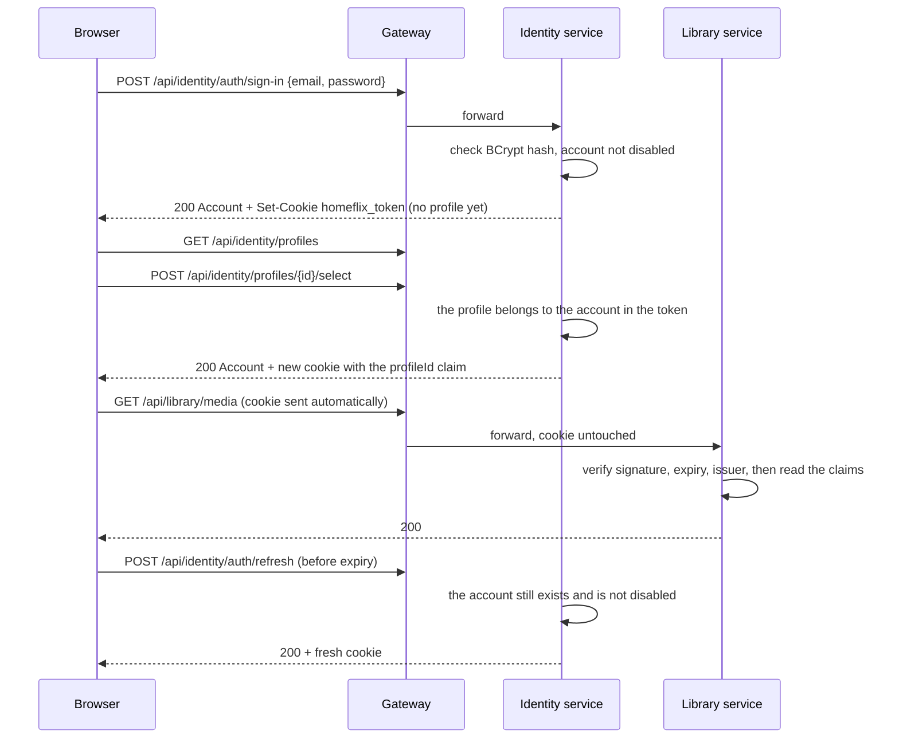

# Identity and permissions design

How HomeFlix signs users in, who may do what, and how each service knows who is calling. Covers ACC-03, ACC-04, ACC-06, ACC-07, ACC-10, PRF-02 and PRF-04, and risks R-06, R-08, R-09, R-10 and R-12 (issue #14). The token format and cookie are decided in [ADR-0009](../adr/0009-jwt-rs256-httponly-cookie.md), which leaves the points below to this document. The endpoints are in [`docs/api/identity.yaml`](../api/identity.yaml). The implementation is G3 to G5, G8 and G9.

## Summary

| Question | Answer |
|---|---|
| Who signs tokens? | Only the identity service, with an RS256 private key. |
| Who verifies them? | Every service, with the public key, on every protected request. The gateway does not authenticate (R-12). |
| Where is the token? | In the `homeflix_token` cookie: `HttpOnly`, `SameSite=Strict`, `Path=/`. Never in JavaScript. |
| How long is it valid? | About 15 minutes, renewed through the identity service. |
| How is access ended? | The renewal fails for a disabled or deleted account. There is no revocation list. |
| Roles | Two: administrator and user (`account.is_admin`). |
| Where do the account and the profile come from? | From the signed token, never from a URL, a body or a header. |
| Passwords | BCrypt, strength 12. |

## Authentication flow

### Token

A JWT signed with RS256 (ADR-0009).

| Claim | Meaning |
|---|---|
| `iss` | `homeflix-identity`. A service rejects any other issuer. |
| `sub` | The account id (uuid). |
| `admin` | `true` for an administrator. |
| `profileId` | The active profile (uuid). Absent until a profile is selected in this session. |
| `iat`, `exp` | Issued at, and expiry: `iat` plus 15 minutes. |

The token carries no email, no password or hash, and no name, so a leaked token reveals as little as possible (SEC-06). The `admin` claim is a copy of `is_admin` at the time of issue.

### Validation in each service

Every service does the same, in one security filter, before any controller runs:

1. Read the token from the `homeflix_token` cookie. A request without it is anonymous.
2. Accept **only RS256**, with the configured public key. Any other algorithm, including `none` and HS256, is rejected, so the public key cannot be used as a secret.
3. Check the signature, `exp` (with at most a few seconds of clock tolerance) and `iss`.
4. Expose `sub`, `admin` and `profileId` to the code as the caller. Nothing else about the caller is trusted.
5. Answer 401 `unauthenticated` for a missing, invalid or expired token, and 403 `forbidden` for a valid token that lacks the permission, using the common error body (ADR-0020).

No service reads the identity service's tables or calls it to validate a request (ACC-07). The identity service validates its own tokens the same way.

### Expiry and renewal

- The lifetime is **15 minutes** (R-10).
- `POST /auth/refresh` takes a **still valid** token and issues a new one for the same account and the same active profile. It reads the account again, so a disabled or deleted account gets a 401 and the session ends within 15 minutes (ACC-10). It does not accept an expired token.
- A role change (`is_admin`) or a disabled account therefore takes effect at the next renewal, at most 15 minutes later. This is accepted to keep the services stateless (ADR-0009, R-10).
- **Renewal is proactive.** The frontend renews at about two thirds of the lifetime (every 10 minutes) while the page is open, and when a hidden tab becomes visible again. A token that has already expired means signing in again, with the expired-session message (ACC-08). This also keeps a long video playing: each new range request carries the cookie, so the cookie must still be valid while the video is watched.
- Signing out clears the cookie on the client. The token itself stays valid until it expires, which is the cost of having no revocation list.

## Roles and permissions

Two roles, stored as `account.is_admin` (requirements, open question 3). A signed-in user without an active profile can only do the operations marked "account".

| Level | Who | Used for |
|---|---|---|
| `anonymous` | Nobody signed in | Setup status, first administrator creation, sign-in, sign-out |
| `account` | Any signed-in, enabled account | Profiles of its own account, the session |
| `profile` | An account with an active profile in the token | Browsing the catalogue, streaming, favourites, progress |
| `admin` | An account with `admin = true` | Everything above for an account, plus management |

| Operation | Anonymous | User | Administrator |
|---|:-:|:-:|:-:|
| Check setup status, create the first administrator (only while none exists) | yes | n/a | n/a |
| Sign in, sign out | yes | yes | yes |
| Renew the session, read the current account | no | yes | yes |
| List, create, delete and select own profiles | no | yes | yes |
| Browse the catalogue, search, filter by genre | no | profile | profile |
| Stream a title | no | profile | profile |
| Favourites and viewing progress | no | own profile | own profile |
| Add, list and remove authorized folders; start an indexing | no | no | yes |
| Edit a title's metadata, remove a catalogue entry | no | no | yes |
| Create, disable, re-enable and delete accounts, change roles | no | no | yes |
| Browse the acquisition catalogue; start, view and cancel downloads | no | no | yes (ACQ-05) |

Rules that apply to every row:

- **The server enforces the matrix** (SEC-02). The interface hides what a user cannot do, but a request made by hand is refused all the same (AS-07).
- An administrator has no extra access to another profile's favourites or progress: they are reached only through the active profile in the token.
- The last administrator cannot be disabled, deleted or demoted, so the installation is never left without one (G8).
- A disabled account cannot sign in (`invalid_credentials`, the same answer as a wrong password, so accounts are not revealed) and cannot renew (ACC-10).

## Profile ownership

The account and the profile always come from the token.

- No endpoint takes an account id or a profile id as input to say *whose* data to read. Library routes such as `/favourites` and `/progress` have no profile in their path: the service uses the `profileId` claim (PRF-04, R-06).
- Where an id is in the URL, it identifies a resource of the caller, and the service checks ownership. `DELETE /profiles/{profileId}` and `POST /profiles/{profileId}/select` look the profile up **by id and by the account in the token**. A profile of another account answers 404, exactly like one that does not exist, so ids cannot be probed.
- A catalogue operation that needs a profile and finds none in the token answers 403 `profile_not_selected`.
- Ids are random uuids (data model conventions), but this is defence in depth: the protection is the ownership check, not the secrecy of the id.
- Tests: profile isolation and disabled accounts (G11), and a review of authorization in every service (K4).

## Selecting the active profile

1. Sign-in succeeds and sets a cookie with **no** `profileId`.
2. The interface lists the account's profiles (`GET /profiles`) and shows the profile screen.
3. The user picks one. `POST /profiles/{profileId}/select` checks that it belongs to the account, then **re-issues the cookie** with the `profileId` claim and a fresh 15 minutes.
4. The interface goes to the catalogue. Switching profile repeats steps 2 and 3, and the old profile's data is no longer reachable (AS-05).

The library service trusts the signed claim for favourites and progress and never asks the identity service. If an account has exactly one profile, the interface may select it automatically; the server rule does not change.

If a profile is deleted while its id is still in a live token, the token stays valid for up to 15 minutes. The favourites and progress of that profile are removed by the cross-service rule (issue #13), so a leftover token can only create orphaned rows, which that rule must tolerate.

## Password storage

- Passwords are hashed with **BCrypt** through Spring Security's `BCryptPasswordEncoder`, **strength 12** (R-08, ACC-04). The salt is part of the BCrypt output.
- Plain passwords are never stored, logged, returned or put in an error message. `password` is write-only in the contract.
- BCrypt reads only the first 72 bytes, so a longer password is **refused** instead of being silently cut: 12 characters at least, 72 bytes at most.
- Sign-in compares against a dummy hash when the email is unknown, so the response time does not reveal which accounts exist (ACC-10).
- No default account or password exists (ACC-02): the first administrator comes from the setup screen, which the server accepts only while no administrator exists, and creates at most one even for simultaneous requests (R-07).

## Keys and secrets

| Item | Held by | How it gets there |
|---|---|---|
| Private key (RS256, 2048 bits or more) | The identity service only | A file in a mounted secret, path given by `IDENTITY_JWT_PRIVATE_KEY_FILE`. |
| Public key | Every service | A file mounted read-only, path given by `JWT_PUBLIC_KEY_FILE`. |
| Database passwords, torrent login | Their own service | `.env`, never committed (SEC-05). |

- The key pair is generated by the operator with a documented command (`openssl genpkey`, then `openssl pkey -pubout`) and is **never committed**. Secret scanning is on (R-11).
- The documentation (L4) lists the variables and the command. The private key is mounted only into the identity container, so a compromise of another service cannot forge tokens (the reason for RS256 over HS256).
- A service that starts without its key file fails to start, with a clear message in the log, instead of accepting unsigned requests.
- **Key rotation** is not part of the MVP. Replacing the key pair signs everyone out, which is acceptable for a home installation. The token carries no `kid` for now; adding one would allow a second public key to be trusted during a change.

## Protection against theft and forgery

- **XSS (R-09):** the cookie is `HttpOnly`, so a script cannot read the token. User text is rendered safely (SEC-03).
- **CSRF (R-09):** `SameSite=Strict`, and the frontend and APIs share one origin through the gateway (ADR-0013). Operations that change state use `POST`, `PUT` or `DELETE`, never `GET`. This is reviewed in K5.
- **Cookie flags:** `Secure` is added when HomeFlix is served over HTTPS, which is a requirement for any Internet exposure (L8).
- **Direct calls (R-12):** services publish no port to the host. Even so, each one verifies the token itself, so a request that bypasses the gateway is still refused.
- **Errors (SEC-04):** a bad token, a wrong password and a missing permission each get a short message without technical details. Reasons go to the server log.
- **Brute force:** not limited in the MVP. Slow BCrypt hashing makes it costly. A delay or lockout after repeated failures is listed as a future extension.

## Decisions and open points

Settled here, as ADR-0009 asks:

- Token lifetime 15 minutes, proactive renewal, no revocation list.
- Disabled-account handling: refuse sign-in and renewal.
- Claims: `iss`, `sub`, `admin`, `profileId`, `iat`, `exp`.
- Active profile: a re-issued cookie carrying `profileId`.
- Key distribution: private key in the identity container only, public key mounted into every service.

Still open:

1. **Frontend renewal.** The frontend (#117) renews once when a request answers 401. With the rule above, a token that has already expired cannot be renewed, so that renewal only works if it happens before expiry. The frontend must renew on a timer and on tab focus. To be agreed with Thomas.
2. **Calls from one service to another.** Operations such as deleting a profile's data in the library, or the acquisition handoff, are made by a service, not by a user. The gateway must not route them, and the receiving service must know the caller is a trusted service. The mechanism is part of the cross-service rules (issue #13) and the inter-service identity work (G5).
3. **Token size and the `admin` claim.** If the roles ever grow beyond administrator and user, the claim becomes a list. Not needed for the MVP.
