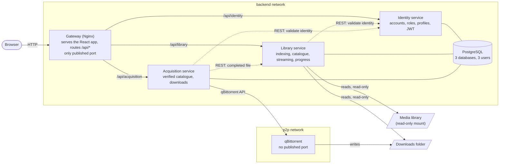

# Architecture overview

Service boundaries, who owns what, and how the parts talk to each other. Covers ARC-01 to ARC-04 and DOC-04. The decisions behind it are in [ADR-0003](../adr/0003-microservice-boundaries.md), [ADR-0006](../adr/0006-postgresql-database-per-service.md), [ADR-0008](../adr/0008-rest-inter-service-communication.md) and [ADR-0013](../adr/0013-nginx-gateway.md).

## Diagram

Solid arrows are the request path or data access. Dotted arrows are calls between services (ADR-0008). Only the gateway publishes a port. The acquisition service is the only one on both networks, so it is the only service that can reach qBittorrent.

## Responsibilities

| Component | Responsibility | Owns | Lead |
|---|---|---|---|
| Gateway | Serves the frontend, routes API paths, turns off buffering on the video route. It does not authenticate anything. | Nothing | Clement |
| Identity and profiles | Accounts, sign-in, roles, viewing profiles, signing the token | `account`, `profile` | Benjamin |
| Library and playback | Indexing, catalogue, metadata, HTTP Range streaming, favourites, viewing progress | `media_root`, `media_file`, `media_item`, `genre`, `media_item_genre`, `favourite`, `progress` | Clement |
| Acquisition | Verified acquisition catalogue, starting and tracking downloads, handing completed files to the library | `acquisition_entry`, `download_job` | Thomas |
| qBittorrent | The BitTorrent engine (third party, ADR-0014) | Its own configuration volume | n/a |

The full table list and relationships are in the [data model](data-model.md).

## Why this is not a distributed monolith

A distributed monolith is several containers that cannot work, change or fail independently. These are the reasons HomeFlix is not one.

1. **Distinct responsibilities (ARC-02).** Each service answers a different question: who is this person, what can they watch, what can we download. None of them is a copy of another.
2. **Each service owns its data (ARC-04).** There is one database and one database user per service, and the user has rights only on its own database (ADR-0006, `db/init/01-create-databases.sh`). No foreign key crosses a service: a reference to another service's row is a plain `uuid` ([data model](data-model.md#references-between-services)). Nobody reads another service's tables.
3. **Services meet only through documented APIs.** Calls go through the REST contracts in [`docs/api`](../api/README.md) (ADR-0008, ADR-0010). There is no shared library of business code and no shared schema.
4. **Identity is verified without calling the identity service for every request.** The token is signed with RS256 and the other services hold only the public key (ADR-0009). They check the signature themselves and read the role from the token.
5. **Failure is contained and visible.** Calls use timeouts, one retry for idempotent GET requests, and a common error format (ADR-0020). When a service is down, the others return an understandable error instead of hanging ([error model](error-model.md), ADR-0020). Playback of an already indexed video does not need the acquisition service.
6. **Each service deploys and tests on its own.** It has its own Dockerfile, its own Flyway migrations, and its own CI job (matrix in `.github/workflows/ci.yml`). A change inside one service does not force a change in another unless its API contract changes.

### Honest limits

- The calls between services are synchronous (ADR-0008), so an outage can spread: if the library cannot reach the acquisition service, a handoff fails until it comes back. The error model defines what the user sees.
- Deleting an account must reach every service (SEC-07). This is a cross-service rule, written in issue #13, not something the database enforces.

## Network and storage

| Concern | Decision |
|---|---|
| Entry point | One published port, on the gateway ([ADR-0013](../adr/0013-nginx-gateway.md)). |
| Networks | `backend` for the gateway, services and PostgreSQL. `p2p` is private between the acquisition service and qBittorrent. |
| Source media | Mounted read-only into the library service (LIB-11). |
| Downloads | qBittorrent writes to the downloads folder. The library service mounts it read-only (ACQ-06). |
| Persistent data | Named volumes for PostgreSQL and the qBittorrent configuration (OPS-04). |

The Compose file is the source of truth: [`compose.yaml`](../../compose.yaml).
