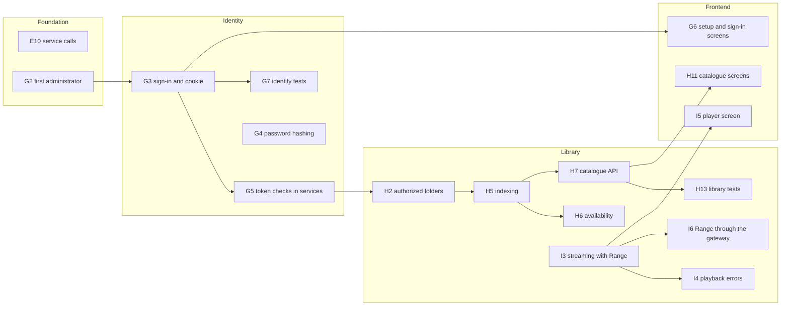

# Prioritized backlog

The order of the work, with sizes, and the epics kept for later sprints (PRC-05, PRC-06, DOC-05, GEN-04; issue #9). The backlog itself is the GitHub issues, grouped by milestone. This page explains the **order** and the **dependencies**, which the issue list does not show. Whether an issue is open or done is read on the board, not here.

## Rules for the order

1. **The vertical slice comes first** (PRC-05): sign in, index a test folder, show the catalogue, play a video with HTTP Range requests, all in Docker and through the interface (GEN-03).
2. **A finished journey beats a long list** (GEN-04). When time is short, a feature outside the ten acceptance scenarios is cut before one inside them.
3. **P0 before P1 before P2** within a milestone. A P0 is something a scenario cannot pass without.
4. **Contracts first.** The OpenAPI contract of an endpoint is written before the code (ADR-0010), so the frontend and the service can be built at the same time.
5. **Day 5 adjusts** the order below with what was learned (N1, #114).

## Sizes

The board has no estimates yet, so these are the team's starting values, to be corrected as the work shows what it really costs. A size is working time for one person, including tests and the review.

| Size | Meaning |
|---|---|
| **S** | Up to half a day. |
| **M** | About one day. |
| **L** | Up to two days. Split it if it grows beyond that. |

## Schedule

The schedule is the brief's, from 16 November 2026 to the presentation on 27 November. The team may also work part of the weekend of 21 and 22 November (requirements, open question 1).

| Milestone | Days | Dates | Purpose |
|---|---|---|---|
| S0, Scope and architecture | 1 | 16 Nov | Documents, design, contracts, runnable foundation. |
| **V, Vertical slice** | 2 to 4 | 17 to 19 Nov | The first end-to-end journey. |
| Day 5, Integrated review | 5 | 20 Nov | Blockers and adjusted priorities. |
| **M, MVP completion** | 6 to 8 | 23 to 25 Nov | Profiles, progress, favourites, acquisition, administration. |
| **A, Acceptance, delivery and presentation** | 9 to 10 | 26 to 27 Nov | Acceptance run, delivery, presentation. |

## The vertical slice (milestone V)

### Order and dependencies

An arrow means "needs it to be finished, or at least its contract written". The frontend screens can start from the contract and use the real service once the arrow's source is done.

### Ordered list

| Order | Issue | Size | Owner | Needs | Why here |
|---|---|---|---|---|---|
| 1 | E10 Inter-service calls | M | Clement | none | Every service-to-service call and every error answer uses it. |
| 2 | G2 First-administrator setup | M | Benjamin | none | The only way to get the first account (ACC-01, ACC-02). |
| 3 | G3 Sign-in, sign-out, token cookie | L | Benjamin | G2 | Nothing protected can be reached without it. The longest item on the critical path. |
| 4 | G4 Password hashing, secrets | S | Benjamin | G2 | Mostly done with G2 (BCrypt). What remains is the key and secret configuration. |
| 5 | G5 Token checks in each service | M | Benjamin | G3 | The library cannot protect its endpoints without it. |
| 6 | H2 Authorized folders | M | Clement | G5 (a stub is enough to start) | Indexing needs a folder to scan. |
| 7 | H5 Idempotent indexing | L | Clement | H2 | Produces the catalogue. |
| 8 | H6 Availability tracking | S | Clement | H5 | Needed so a removed file does not break the catalogue. |
| 9 | H7 Catalogue API | M | Clement | H5 | The home, search and genre screens read it. |
| 10 | I3 Streaming with Range | M | Clement | H4 (done) | Can run in parallel with 6 to 9. Seeking depends on it. |
| 11 | I4 Playback error handling | S | Clement | I3 | Missing, denied and unsupported files give a clear answer (PLY-05). |
| 12 | I6 Range through the gateway | S | Clement | I3 | The browser reaches the library only through the gateway. |
| 13 | G6 Setup and sign-in screens | M | Thomas | G3 contract | The administrator and members need a way in. |
| 14 | H11 Home, catalogue, search, genre screens | L | Thomas | H7 contract | The catalogue screens. |
| 15 | I5 Player screen | M | Thomas | I3 contract | Play, pause, seek, volume, fullscreen. |
| 16 | G7 Authentication and authorization tests | M | Benjamin | G3, G5 | Proves anonymous and wrong-role requests are refused (ACC-06). |
| 17 | H13 Indexing and file-access tests | M | Clement | H5 | Proves no duplicate and no path escape (LIB-05, LIB-08). |

Already finished in this milestone: E11, E12, G1, H1, H3, H4, H12 and I1.

### Critical path

**G2, then G3, then G5, then H2, then H5, then H7, then H11.** A delay anywhere in this chain delays the first complete journey. Items 10 to 12 (streaming) are off this path and can be built in parallel by the same person while they wait for a review.

### The slice is done when

A person can: start HomeFlix with Docker Compose, create the first administrator, sign in, add a test folder, index it, see the titles, search, open one, and play it with the timeline working. This is AS-02 and AS-03, and the first half of AS-01.

## MVP completion (milestone M)

Four epics, each a set of issues that deliver one visible capability. The order inside the milestone follows what other work depends on.

| Order | Epic | Issues | Size | Why this order |
|---|---|---|---|---|
| 1 | **Profiles** | G9 profiles and active-profile selection (M), G10 profile screen (M), G11 isolation tests (S) | 3 to 4 days | Favourites and progress need an active profile in the token, so this comes first. Scenario AS-05. |
| 2 | **Progress and resume** | I7 save and resume (M), I9 continue watching and reset (M), I10 screens (M), I11 playback tests (M) | 4 days | Scenario AS-04. Depends on profiles. |
| 3 | **Favourites** | I8 My List (S), part of I10 | 1 day | Small, and shares the profile work. |
| 4 | **Acquisition** | J1 test file and rights evidence (S), J3 verified catalogue (M), J4 isolated torrent client (M), J5 start and cancel (M), J6 status tracking (M), J7 checks and handoff (M), J8 library side of the handoff (M), J9 screens (M), J10 real transfer (M) | 8 to 9 days | Scenario AS-06. The longest epic, so it **starts first** and runs alongside the others (Thomas). The real transfer is mandatory (ACQ-14). |
| 5 | **Administration** | G8 account management (M), K1 administration area (L), H8 metadata editing and entry removal (M), H9 poster validation (S), H10 image rules at the gateway (S), K2 account deletion (M), K3 delete a profile's data (S) | 6 to 7 days | Scenarios AS-07 and part of AS-09. The deletion rules are in the [consistency rules](../architecture/consistency-rules.md). |

Also in M: **I2**, demonstration videos with their source and licence (S, Thomas), needed for every scenario that plays a video.

### If time is short

In this order, the first things to leave out are:

1. Parts of K1 beyond accounts, indexing and the download screens (the administration area can be several pages instead of one).
2. H10, the image host rules at the gateway, if H9 already refuses unsafe poster addresses (the risk is lower, but SEC-12 then stays open and is written as a known limit).
3. The continue-watching and My List sections of I10, keeping resume itself.

Never leave out: the real peer-to-peer transfer (J10), the profile isolation tests (G11, K4), and the server-side checks (ACC-06, SEC-02).

## Acceptance, delivery and presentation (milestone A)

Days 9 and 10. The work is fixed and known, so it is listed by group and not ordered one by one.

| Group | Issues | Notes |
|---|---|---|
| Acceptance run | K8 plan and run of the 10 scenarios (L), K9 integration tests (M), K13 restart persistence (S) | The run produces the results that L7 and K12 record. |
| Review and security | K4 authorization and isolation (M), K5 security review (M), K6 file, mount and network audit (M), K7 keyboard and mobile review (M) | Findings go to K12 as defects or residual risks. |
| AI agent | K10 run and report (M), K11 verification of each finding (M) | Scenario AS-10. The agent's dry-run (D2) is done earlier. |
| Installation and documentation | L1 README (M), L2 clean install on another machine (M), L3 tested environments (S), L4 configuration (M), L5 backup and restore (M), L6 demonstration accounts (S), L7 test commands and index (S), L8 Internet exposure requirements (S), L9 evaluated tag and known limits (S) | L2 needs a finished README, so L1 comes first. |
| Presentation | L10 repeatable peer-to-peer demo (M), L11 slides (M), L12 to L14 one part each (S), M1 to M3 demo video (M each) | L10 is rehearsed on the real presentation network. |
| Results | K12 record results, defects and risks (S) | After K8 to K11. |

## Epics for later

These come after the MVP is complete and stable (GEN-04). The detailed list, with reasons, is the out-of-scope list.

- Series, seasons and episodes.
- Transcoding and more video formats.
- Recommendations from viewing history.
- Parental controls, household invitations and extra profile controls.
- Mobile or TV applications.
- Remote Internet access. Only its requirements are written (L8).
- Password reset, and a delay or lockout after repeated failed sign-ins.
- A new revocation mechanism for tokens, if the 15-minute window turns out to be too long.
- Uploading a poster image instead of entering an address.

## Open points

- **Estimates are values to be corrected,** not commitments. They are set again at Day 5.
- **Owners:** the unassigned issues (K4 to K6, K8, K9, K11, K12, L7, L8, L11, M1 to M3) are shared work of the whole team and are assigned at Day 5.
